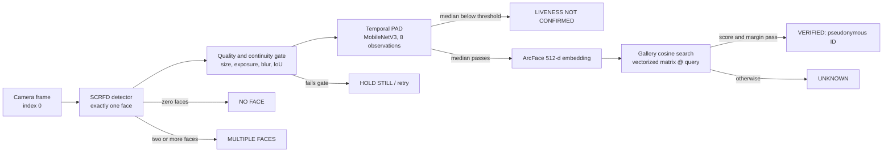

# Architecture

FaceGuard AI is a local, fail-closed **academic prototype** that combines face
recognition with RGB presentation-attack detection (PAD). This document describes the
implemented runtime, not a production security architecture.

## Processing flow

Identity matching is never executed until PAD evidence has passed. The recognition
stage receives an embedding that was already computed for the same single detected
face, so it cannot produce an identity on a frame that PAD rejected.

## Stages

| Stage | Implementation | Contract |
|---|---|---|
| Capture | `src/faceguard/session.py`, `scripts/run_demo.py` | Camera `0` only. A bounded latest-frame queue drops the oldest waiting frame; processing delay cannot grow without bound. |
| Detection | `InsightFaceEmbedder` with `buffalo_m` SCRFD `det_2.5g.onnx` | Exactly one detected face; zero or multiple faces reset the track and fail closed. |
| Quality gate | `VideoVerifier._quality_reason` | Detection score ≥ `0.6`, face box ≥ `80 px`, mean brightness in `[40, 215]`, Laplacian variance ≥ `40`. Failures produce a retry state. |
| Continuity | `VideoVerifier` IoU track | The same face must overlap the previous box with IoU ≥ `0.3` within `500 ms`; otherwise the PAD evidence is reset and a new track starts. |
| PAD | `OnnxPadModel` with `mobilenetv3_pad.onnx` | 1.3× face crop, 224×224 RGB, ImageNet normalization, sigmoid liveness score. The median of 8 consecutive observations must be ≥ `0.7626009583473206`. |
| Embedding | ArcFace `w600k_r50.onnx` | L2-normalized 512-dimensional vector. |
| Gallery search | `Gallery.rank`/`search` | One matrix-vector product per query, then a per-identity maximum. The top-1 cosine score must be ≥ `0.6713641881942749`; the top-1/top-2 margin must be ≥ `0.0`; exact ties are rejected. |
| Output | `VerificationResult.event` | Status, state, pseudonymous ID (only after PAD), one decision score, PAD score, PAD observation count, track ID, model version, reason and latency. No frame, crop, bounding box or embedding. |

## Runtime states and operator overlay

| Overlay | Pipeline state/status | Meaning |
|---|---|---|
| `NO FACE` | `RETRY` / `retry` | No single face is available; no identity is possible. |
| `MULTIPLE FACES` | `RETRY` / `retry` | More than one face is visible; each detected face is boxed for operator guidance, but identities are not checked. |
| `HOLD STILL` | `RETRY` / `retry` | Quality, continuity, timing or model check failed; present one steady, well-lit face. |
| `CHECKING LIVENESS` | `COLLECTING_PAD` | PAD observations are being collected; identity matching has not run. |
| `LIVENESS NOT CONFIRMED` | `PAD_FAILED` / `spoof` | Median liveness is below threshold. The UI avoids claiming a confirmed attack; recognition is never called. |
| `UNKNOWN` | `UNKNOWN` / `unknown` | PAD passed but the gallery score or margin did not accept an identity. This is a valid fail-closed result. |
| `VERIFIED: <ID>` | `IDENTIFIED` / `verified` | PAD passed and the gallery accepted the pseudonymous enrollment label. |

Structured events are printed only when the pipeline state changes. A continuous
track that keeps the same terminal result is not reprinted on every frame, so no
per-frame similarity history is emitted.

`ENDED` is emitted once on shutdown. `Ctrl+C` is reported as `interrupted` and returns
exit code `130`; a missing camera or an unrecoverable camera read failure returns `2`.

## Optional metrics dashboard

`scripts/run_demo.py --metrics-ui` starts a separate Tkinter dashboard in an isolated
process. It receives aggregate snapshots only: state, processed FPS, median/p95 frame
age, pipeline median latency, processed/captured/dropped counts, PAD observation count
and elapsed time. Frames, crops, embeddings and per-frame score histories are never
sent to it. Closing the window stops the pipeline through the same clean-shutdown path
as `q`/`Esc`; a Tk failure degrades to the OpenCV preview with a warning. The default
OpenCV preview remains the video surface, so the dashboard is additive rather than a
replacement UI.

## Centralized desktop interface

`scripts/run_app.py` is the recommended interactive entry point. It uses the shared
runtime factory in `src/faceguard/bootstrap.py`, the bounded capture/inference session
in `src/faceguard/session.py`, and pure operator-message mappings in
`src/faceguard/presentation.py`. Tkinter remains on the main thread while camera
capture and inference run in separate bounded workers. The UI receives only the newest
in-memory display frame and result, so a slow renderer cannot create an unbounded frame
history.

The desktop app automatically checks model/gallery hashes and providers before it
enables **Start camera**. It never opens the camera on application launch, and it does
not expose controls that bypass PAD, change thresholds, train models, record frames or
perform single-image liveness decisions.

Face boxes are presentation-only data attached to an in-memory result and are never
included in `VerificationResult.event()`. A single verified face receives its accepted
local display label. Multiple faces receive numbered `IDENTITY NOT CHECKED` boxes;
per-face identification is deliberately withheld because the current verifier has one
PAD evidence track and one identity decision per session.

## Configuration and startup integrity

`configs/runtime.yaml` pins the ONNX Runtime provider, model roots, filenames, SHA-256
hashes, gallery hash, PAD preprocessing, thresholds and runtime quality limits. Startup
verifies every artifact hash and refuses to use a different provider. It never downloads
weights; installation is a separate, explicitly acknowledged operator step. See
[PROTOTYPE_MODEL_CARD.md](PROTOTYPE_MODEL_CARD.md) for the artifact list.

Recognition uses no SVM or trained classifier. The gallery is a vectorized cosine
comparison (`matrix @ query`) with a per-person maximum.

## Privacy boundary

Frames and crops exist only in memory for the duration of one inference step. The
application writes no video, frames, crops or embeddings; reports contain aggregate
values only. See [PRIVACY.md](PRIVACY.md).

## Limitations

The system is exploratory. The recognition split was created without session or device
metadata, PAD performance is weak against many presentation attacks, and neither metric
is a production security guarantee. The complete mandatory limitation list appears in
[PROTOTYPE_MODEL_CARD.md](PROTOTYPE_MODEL_CARD.md#limitations) and
[EVALUATION.md](EVALUATION.md).
