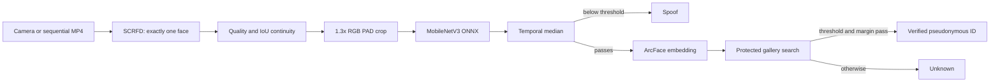

# Runtime pipeline

## Current status

The maintainable runtime code is implemented and tested, the PAD candidate is
installed privately, and the exploratory recognition protocol/gallery are frozen.
The official `buffalo_m` ZIP and extracted detector/recognizer files passed their
frozen hashes. The full CPU runtime and a fresh private-image query loaded successfully
without opening a camera. Sequential-video and target-camera evaluation remain.

The source `frad_embeddings.npz` remains an audit artifact. Only the explicitly
selected enrollment rows were promoted into the protected gallery.

### Frozen exploratory recognition receipt

- Labels: 234 exact strings (`000`, then `0001` through `0233`), never renumbered.
- Enrollment: 1,430 vectors across 187 identities.
- Validation: 367 known probes plus 265 probes from 23 unknown identities.
- Test: 367 known probes plus 280 probes from 24 different unknown identities.
- Session/device fields: empty and explicitly unknown; never inferred from filenames.
- Cosine threshold: `0.6713641881942749`, selected on validation only.
- Validation unknown FPIR: 0/265; known identification failure: 12/367.
- Exploratory test unknown FPIR: 5/280 (1.79%); known identification failure: 15/367.

These results are not an official FRAD or cross-session benchmark and are not a
production security guarantee.

## Architecture



No frame or embedding is included in the structured result event. Live camera mode
uses a bounded latest-frame queue and drops the oldest waiting frame under load.
Sequential video mode processes every frame in order for accuracy evaluation.

## Source layout

| Path | Responsibility |
|---|---|
| `src/faceguard/gallery.py` | Gallery validation, enrollment, deletion and open-set matching |
| `src/faceguard/pad.py` | Exact PAD crop/preprocessing and hash-verified ONNX inference |
| `src/faceguard/pipeline.py` | Temporal PAD-before-recognition state machine |
| `src/faceguard/runtime.py` | Bounded latest-frame queue |
| `src/faceguard/runtime_config.py` | Strict, no-unknown-key runtime configuration |
| `src/faceguard/recognition_metrics.py` | Validation-only threshold selection |
| `scripts/run_demo.py` | Thin video/webcam entry point |

Private weights and galleries stay under `models/private/` and are ignored by Git.

## Reproducible setup sequence

### 1. Promote the trained PAD bundle

```bash
.venv/bin/python scripts/prepare_runtime_artifacts.py \
  --pad-bundle data/processed/pad_model_bundle.zip \
  --output-dir models/private/pad_candidate
```

The command checks the ZIP CRC and the internal ONNX, checkpoint and configuration
hashes before using atomic writes with mode `0600`.

### 2. Install the official local InsightFace pack

Download/retrieve the official `buffalo_m` ZIP under its applicable terms, then run:

```bash
.venv/bin/python scripts/install_insightface_pack.py \
  --pack-zip /private/path/buffalo_m.zip \
  --model-root models/private/insightface \
  --acknowledge-non-commercial-model-terms
```

The installer never downloads weights. It promotes only the detector and recognizer
after first matching the official package SHA-256
`d98264bd8f2dc75cbc2ddce2a14e636e02bb857b3051c234b737bf3b614edca9`, then matching
the detector and recognizer hashes frozen in `configs/decisions.yaml`.

### 3. Freeze recognition manifests

Create explicit enrollment, validation-known, validation-impostor, test-known and
test-impostor CSVs. A known probe must not reuse an enrollment file hash. Impostor
identities must not occur in the gallery. Do not infer sessions from filenames.

The current manifests were generated reproducibly with:

```bash
.venv/bin/python scripts/create_recognition_split.py \
  --embedding-archive models/private/frad_candidate_embeddings/frad_embeddings.npz \
  --output-dir data/manifests \
  --seed 42 \
  --unknown-identity-fraction 0.2 \
  --known-probe-fraction 0.2
```

The enrollment CSV consumed by `build_gallery.py` requires:

```text
relative_path,verified_person_id,source_sha256
```

### 4. Build the private gallery

Validate the five populated manifests first:

```bash
.venv/bin/python scripts/validate_recognition_manifests.py \
  --dataset-root data/processed/frad_legacy_crops \
  --enrollment data/manifests/recognition_enrollment.csv \
  --val-known data/manifests/recognition_val_known.csv \
  --val-impostor data/manifests/recognition_val_impostor.csv \
  --test-known data/manifests/recognition_test_known.csv \
  --test-impostor data/manifests/recognition_test_impostor.csv \
  --allow-unknown-session-metadata \
  --output reports/audits/recognition_split_validation.json
```

Use `--allow-unknown-session-metadata` only after recording that limitation in
`FRAD_SESSION_POLICY`; it is not equivalent to verified cross-session evaluation.

```bash
.venv/bin/python scripts/build_gallery.py \
  --embedding-archive models/private/frad_candidate_embeddings/frad_embeddings.npz \
  --enrollment-manifest data/manifests/recognition_enrollment.csv \
  --output models/private/gallery/gallery.npz
```

Copy the printed `gallery_sha256` into `configs/runtime.yaml` only after reviewing
the enrollment manifest and report.

### 5. Calibrate recognition

Generate one row per validation gallery search:

```bash
.venv/bin/python scripts/evaluate_recognition.py \
  --embedding-archive models/private/frad_candidate_embeddings/frad_embeddings.npz \
  --gallery models/private/gallery/gallery.npz \
  --gallery-report models/private/gallery/gallery.json \
  --known-manifest data/manifests/recognition_val_known.csv \
  --impostor-manifest data/manifests/recognition_val_impostor.csv \
  --output reports/private/recognition_validation_scores.csv
```

Then select the threshold using a declared validation policy:

```bash
.venv/bin/python scripts/calibrate_recognition.py \
  --validation-scores reports/private/recognition_validation_scores.csv \
  --output reports/evaluation/recognition_threshold.json \
  --policy recognition_fmr_bound \
  --max-fmr 0.001 \
  --min-margin <VALIDATION_SELECTED_MARGIN>
```

The FMR target and margin are project decisions, not defaults. Put the resulting
threshold and reviewed margin into `configs/runtime.yaml`. Never tune them on test.

The current exploratory run used `recognition_fmr_bound` with validation FMR bound
`0.0`. The held-out exploratory test was evaluated afterward using:

```bash
.venv/bin/python scripts/report_recognition.py \
  --scores reports/private/recognition_test_scores.csv \
  --threshold-report reports/evaluation/recognition_threshold.json \
  --protocol test \
  --output reports/evaluation/recognition_test.json
```

### 6. Verify runtime startup without opening a camera

```bash
.venv/bin/python scripts/run_demo.py \
  --config configs/runtime.yaml \
  --check-only \
  --readiness-report reports/environments/runtime_readiness.json
```

This loads the hash-pinned SCRFD, ArcFace and PAD ONNX sessions plus the private
gallery. The JSON receipt must report `"camera_opened": false` and the configured
CPU provider before any camera permission is requested.

### 7. Run sequential video before webcam

```bash
.venv/bin/python scripts/run_demo.py \
  --config configs/runtime.yaml \
  --video /private/path/evaluation.mp4 \
  --no-display
```

After spoof, unknown, enrolled, no-face, multi-face and interruption MP4 cases pass:

```bash
.venv/bin/python scripts/run_demo.py --config configs/runtime.yaml --camera 0
```

## Verification

```bash
.venv/bin/python -m pytest -q
.venv/bin/python -m pip check
.venv/bin/python scripts/preflight.py \
  --output reports/environments/environment_local_runtime.json
```

The current PAD candidate has a test APCER of approximately 20.84%. It is suitable
for pipeline integration and further evaluation, not a production security claim.

PAD manifest generation and training startup both reject subject, source-hash and
relative-path overlap across train/validation/test. The returned PAD bundle records
the three manifest hashes but does not contain the CSV rows, so those CSVs must be
retrieved from the training run before its subject-disjoint split can be independently
audited and frozen for release.
