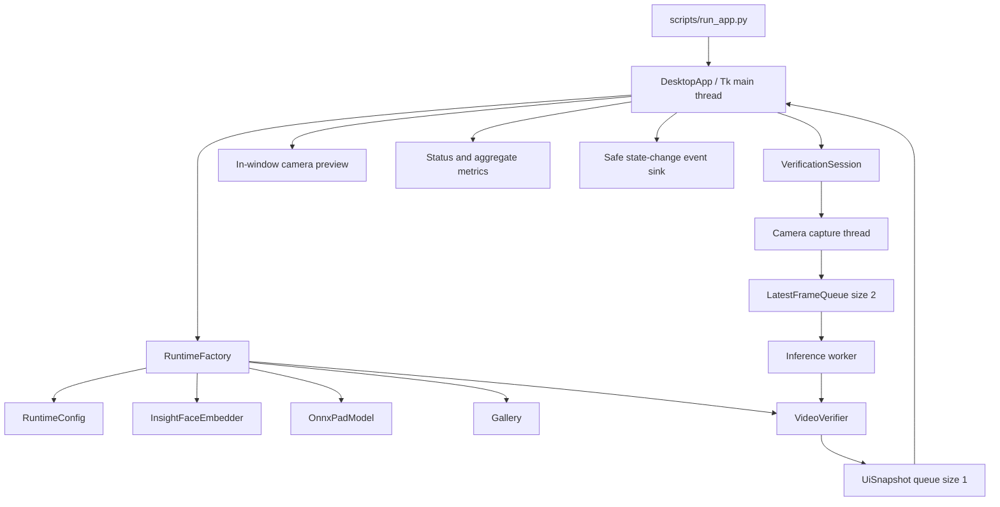

# FaceGuard centralized desktop application plan

## 1. Purpose

This document defines the implementation plan for converting the current FaceGuard
command-line demonstration into one centralized local desktop application.

The operator should need only one command:

```bash
.venv/bin/python scripts/run_app.py
```

The application will then:

1. load `configs/runtime.yaml`;
2. verify the detector, recognizer, PAD model, gallery and configured hashes;
3. display a clear readiness result;
4. open authorized camera `0` only after the operator presses **Start camera**;
5. run the complete detection -> quality -> temporal PAD -> recognition pipeline;
6. show the live camera image and the current fail-closed result in one window;
7. display aggregate performance information; and
8. stop the worker threads and release the camera cleanly.

This is an interface plan for the existing academic prototype. It does not change the
recorded model accuracy, authorize production use, or remove any unresolved validation
requirements.

### Implementation update — 25 October 2026

Phases UI-0 through UI-4 are implemented. The shared bootstrap, bounded threaded
session, presentation layer, professional single-window Tkinter/Pillow interface and
`scripts/run_app.py` launcher are present. The full suite passes 116 tests, and a real
camera-free window smoke test completed readiness and closed cleanly without opening
the camera.

UI-5 remains partially open: the five authorized camera acceptance cases and a
full-path benchmark with a face present still require an operator-controlled session.

## 2. Current codebase assessment

The core analysis pipeline already exists and should be reused. The GUI must not
reimplement computer-vision or matching logic.

| Existing capability | Current location | GUI use |
|---|---|---|
| Strict runtime configuration | `src/faceguard/runtime_config.py` | Load all paths, hashes, providers, thresholds and queue settings. |
| SCRFD detection and ArcFace embedding | `src/faceguard/models.py` | Analyze each frame using the frozen InsightFace pack. |
| PAD preprocessing and inference | `src/faceguard/pad.py` | Produce the liveness observation for the detected face. |
| Temporal fail-closed state machine | `src/faceguard/pipeline.py` | Produce `NO FACE`, `MULTIPLE FACES`, `HOLD STILL`, `CHECKING LIVENESS`, `SPOOF`, `UNKNOWN` or `VERIFIED`. |
| Protected gallery search | `src/faceguard/gallery.py` | Match only after temporal PAD passes. |
| Bounded latest-frame queue | `src/faceguard/runtime.py` | Prevent an increasing live-video processing delay. |
| Rolling aggregate metrics | `src/faceguard/telemetry.py` | Show FPS, latency, frame age and dropped-frame counts. |
| Runtime bootstrap | `scripts/run_demo.py:build_verifier` | Move into importable source code and reuse from both CLI and GUI. |
| Camera/video loops and reconnect | `scripts/run_demo.py` | Extract into an application session service. |
| Existing metrics window | `src/faceguard/telemetry.py` | Reuse its visual language, but replace the separate window with one integrated interface. |
| Gallery inspection/deletion | `scripts/manage_gallery.py` | Keep outside the first GUI version until mutations are release-aware. |

As of 25 October 2026, the intended `.venv` passes 91 automated tests and `pip check`.
The configured models and gallery also pass the camera-free readiness check. The main
interface problem is therefore orchestration and presentation, not missing inference
algorithms.

### Current architectural limitation

`scripts/run_demo.py` currently owns too many responsibilities:

- building and verifying the runtime;
- opening camera/video sources;
- producer-thread and reconnect management;
- invoking the verification state machine;
- formatting events;
- drawing the OpenCV overlay; and
- controlling the optional metrics window.

A centralized app should not import a script or launch it as a subprocess. These
responsibilities must first be exposed through reusable classes under `src/faceguard/`.

## 3. Recommended interface technology

Use standard **Tkinter** for the window and **Pillow/ImageTk** to display OpenCV frames.

Reasons:

- the repository already contains a working Tkinter metrics dashboard;
- Pillow is already pinned in `requirements-runtime.in`;
- no browser, web server, account, network connection or JavaScript build is needed;
- all frames can remain in local process memory; and
- this adds less packaging risk than PySide6, Electron or a local web stack.

Tkinter must become an explicit desktop prerequisite. Startup should detect an absent
Tk installation and show one actionable error instead of falling back to multiple
windows.

## 4. Target user experience

### 4.1 Main window

```text
+------------------------------------------------------------------+
| FaceGuard AI     Academic Prototype       SYSTEM READY       [x] |
+------------------------------------------+-----------------------+
|                                          | Verification          |
|                                          |                       |
|            LIVE CAMERA IMAGE             |  CHECKING LIVENESS    |
|                                          |  PAD evidence: 5 / 8  |
|                                          |                       |
|                                          |  Identity: hidden     |
+------------------------------------------+-----------------------+
| [Check system] [Start camera] [Stop]      | FPS: 5.9             |
| Source: Authorized camera 0               | Latency: 42 ms       |
|                                           | Dropped frames: 0    |
+------------------------------------------+-----------------------+
| Privacy: frames, crops and embeddings are not saved.             |
+------------------------------------------------------------------+
```

### 4.2 Required visible states

| Pipeline result | UI message | UI treatment |
|---|---|---|
| Startup not checked | `SYSTEM NOT CHECKED` | Start disabled. |
| Startup check failed | `SYSTEM BLOCKED` plus safe reason | Start disabled; retry check allowed. |
| Ready but stopped | `READY` | Start enabled. |
| No face | `NO FACE` | Neutral warning; identity blank. |
| Multiple faces | `MULTIPLE FACES` | Draw a numbered box around each face; identity matching remains disabled. |
| Quality/continuity retry | `HOLD STILL` | Guidance; identity blank. |
| PAD accumulating | `CHECKING LIVENESS` | Show `n / 8`; identity blank. |
| PAD rejected | `LIVENESS NOT CONFIRMED` | Amber result; recognition must not run and the UI must not claim a confirmed attack. |
| PAD passed, gallery rejected | `UNKNOWN` | Amber result; no guessed identity. |
| PAD and gallery accepted | `VERIFIED: <ID>` | Green result; show only the pseudonymous ID. |
| Camera disconnected | `RECONNECTING` | Reset verifier and identity display. |
| Camera cannot reconnect | `CAMERA ERROR` | Session stops and Start becomes available after cleanup. |

The app must never show an identity during quality checks or PAD collection. It must
not keep a previously verified identity visible after a reset, disconnect, no-face or
multi-face result.

### 4.3 Controls

The first version should contain only these operator controls:

- **Check system**: loads configuration and verifies all private artifacts.
- **Start camera**: opens camera `0` and starts the complete pipeline.
- **Stop**: ends analysis, clears the displayed frame and releases the camera.
- **Advanced diagnostics**: expands aggregate FPS/latency/frame counters.
- **Exit**: follows the same stop-and-release path before closing the app.

The app may auto-run **Check system** during startup, but it must not open the camera
without the operator pressing **Start camera**.

### 4.4 Features deliberately excluded from version 1

- No cloud API or remote web dashboard.
- No recording, screenshot or export-frame button.
- No automatic camera enumeration; only authorized camera `0`.
- No threshold/model editing from the UI.
- No model training from the UI.
- No tracked/public conversion of pseudonymous IDs into real names. An authorized
  local UI-only alias may be loaded from Git-ignored
  `configs/private/identity_labels.yaml`; canonical gallery IDs and structured events
  remain unchanged.
- No single-image liveness or verification mode. PAD requires a temporal sequence of
  observations, so a still-image result would violate the current runtime contract.
- No gallery enrollment button until a consented multi-image enrollment and release
  update workflow exists.
- No direct gallery deletion in version 1. Deletion changes the gallery hash and would
  make `configs/runtime.yaml` fail closed unless the release/config is updated
  atomically.

An authorized MP4 input can be added later as a clearly labelled test mode. It should
not be presented as live camera authentication.

## 5. Target architecture



### Threading rules

1. The Tkinter main loop is the only thread allowed to update widgets.
2. A capture thread reads camera frames and writes to the existing bounded
   `LatestFrameQueue`.
3. One inference worker consumes the newest frame and calls `VideoVerifier.process`.
4. The worker publishes a `UiSnapshot` to a bounded queue. If the UI is behind, replace
   the older pending snapshot rather than accumulating frames.
5. Tkinter polls the snapshot queue using `root.after(...)` and renders the newest
   result.
6. Stop/exit sets one cancellation event, joins both workers with bounded timeouts,
   releases `cv2.VideoCapture`, calls `verifier.end()` and clears the preview.
7. Camera reconnect resets the verifier before new frames are accepted.

The UI preview frame is allowed only in memory. It must never be placed in a structured
event, exception report, log or saved session history.

## 6. Proposed source changes

### 6.1 Runtime bootstrap service

Create `src/faceguard/bootstrap.py`:

```text
RuntimeBundle
  - config
  - verifier
  - readiness

RuntimeFactory.load(config_path, project_root) -> RuntimeBundle
RuntimeFactory.check(config_path, project_root) -> ReadinessResult
```

Move the logic currently in `scripts/run_demo.py:build_verifier` and the camera-free
readiness dictionary construction into this module. It should preserve the same
configuration, artifact-hash and provider checks.

Both `scripts/run_demo.py` and the GUI must call this factory so there is only one
startup path.

### 6.2 Reusable session controller

Create `src/faceguard/session.py` with:

- `SessionStatus`: `IDLE`, `STARTING`, `RUNNING`, `RECONNECTING`, `STOPPING`, `FAILED`,
  `STOPPED`;
- `SessionOptions`: camera index, reconnect attempts and reconnect delay;
- `UiSnapshot`: sequence, in-memory display frame, verification result, rolling
  metrics and camera/session status;
- `SessionSummary`: aggregate counts and clean-shutdown result; and
- `VerificationSession`: `start()`, `stop()`, `join()`, `latest_snapshot()` and
  `is_running`.

Move camera producer, bounded queue, reconnect and shutdown behavior out of
`scripts/run_demo.py:run_camera` into this class. Keep the sequential-video loop in a
separate reusable function or source class so the CLI remains compatible.

The controller should expose typed state/callbacks, not print from worker threads.
Console JSON output belongs in a CLI event sink; Tk rendering belongs in a GUI event
sink.

### 6.3 Presentation mapping

Create `src/faceguard/presentation.py` containing pure functions:

- `operator_message(result) -> str`;
- `status_color(result) -> str`;
- `safe_event(sequence, result) -> dict`; and
- `clear_identity_on(result) -> bool`.

Move `OVERLAY_MESSAGES` and `overlay_text` from `scripts/run_demo.py` here. This avoids
the CLI and GUI displaying different meanings for the same pipeline state.

### 6.4 Desktop UI package

Create:

```text
src/faceguard/ui/
  __init__.py
  app.py             # window lifecycle and navigation
  live_view.py       # preview, result and controls
  diagnostics.py     # readiness details and rolling metrics
  theme.py           # colors, spacing and typography
```

Responsibilities:

- `app.py` owns the Tk main loop, startup check and graceful exit.
- `live_view.py` converts the newest BGR frame to RGB, resizes it while preserving
  aspect ratio, creates an `ImageTk.PhotoImage`, and keeps the active image reference.
- `diagnostics.py` renders aggregate values already supplied by `RollingMetrics` and
  safe readiness metadata.
- `theme.py` defines one consistent palette, including accessible text contrast and
  status colors that are not the sole carrier of meaning.

Do not import model-specific code from UI widgets. Widgets talk only to the runtime
factory, session controller and presentation layer.

### 6.5 Thin application launcher

Create `scripts/run_app.py` with only:

- project-root resolution;
- `--config` parsing, defaulting to `configs/runtime.yaml`;
- optional `--camera 0`, rejecting every other camera for the current scope;
- application construction; and
- process exit-code mapping.

The script should return:

- `0` after a normal clean close;
- `2` for blocked startup/camera failure; and
- `130` for a terminal interrupt.

### 6.6 Preserve the current CLI

Refactor `scripts/run_demo.py` to call the new source services. Do not remove its
existing commands because they are valuable for automated tests, headless use,
benchmarks and container readiness checks.

The OpenCV preview and separate metrics dashboard can be marked as the legacy/headless
operator path after the centralized GUI passes acceptance tests.

## 7. Runtime sequence

### Application startup

1. Construct the main window with Start disabled.
2. Display `CHECKING SYSTEM`.
3. Run `RuntimeFactory.load` in a background initialization worker so the window does
   not freeze while ONNX sessions load.
4. Report progress by stage: configuration, face pack, PAD model and gallery.
5. On success, retain the `RuntimeBundle`, display `READY`, and enable Start.
6. On failure, display a safe actionable message and keep Start disabled.

### Camera session

1. Operator presses Start.
2. Disable Start and readiness/config actions for the active session.
3. Open camera `0`; do not enumerate or silently switch cameras.
4. Start capture and inference workers.
5. Render the newest in-memory frame and result snapshot.
6. Emit safe structured data only when the pipeline state changes.
7. If reads fail, show reconnect state and apply the existing bounded retry policy.
8. On Stop, error or Exit, clear identity immediately and perform the unified shutdown
   sequence.

### Restarting a session

Every new Start must use a reset verifier/session. PAD observations, track IDs,
previous identity and terminal state must not leak across sessions.

## 8. Privacy and safety requirements

- Preserve PAD-before-recognition ordering without a GUI bypass.
- Never add a "skip liveness" control.
- Never display a person ID unless `result.status == "verified"`.
- Clear identity on Stop, retry, spoof, unknown, disconnect and startup failure.
- Keep camera frames and Tk image objects in memory only.
- Do not store frame history for replay.
- Do not include frames, crops, embeddings or bounding boxes in logs.
- Keep readiness information limited to hashes, providers and aggregate gallery counts.
- Avoid showing raw exception traces to the operator; send a safe message to the UI
  and an exception type/message to local stderr when appropriate.
- Do not create network listeners or telemetry.
- Preserve `models/private/`, `data/processed/` and `reports/private/` boundaries.
- Label the window `Academic Prototype - Not for Security Access Control`.

## 9. Test plan

### Unit tests

Add:

```text
tests/unit/test_bootstrap.py
tests/unit/test_session.py
tests/unit/test_presentation.py
tests/unit/test_app_controller.py
```

Required cases:

- startup success exposes the expected readiness fields;
- a missing/mismatched model keeps Start disabled;
- only camera `0` is accepted;
- Stop before/while/after startup is idempotent;
- the latest-frame and latest-snapshot queues remain bounded;
- state-to-message/color mapping covers every `VerificationState`;
- identity is hidden before PAD and after every reset condition;
- reconnect resets PAD/track state;
- unrecoverable camera failure becomes `FAILED` and releases the capture;
- closing the main window uses the same shutdown path as Stop;
- no worker thread remains alive after shutdown; and
- safe events contain no frame, crop, embedding or bounding box.

### Integration tests

Add synthetic or authorized non-biometric fixtures under `tests/fixtures/` and verify:

- a short sequential video reaches expected state transitions;
- no-face, multiple-face, spoof, unknown and verified presenter states render correctly;
- UI polling can fall behind without unbounded memory growth;
- repeated start/stop cycles do not retain state;
- camera disconnect/reconnect updates the interface correctly; and
- a headless Tk smoke test constructs and closes the window. CI may require `xvfb-run`.

Do not place real biometric frames in tracked tests.

### Manual desktop acceptance

After automated tests pass, perform:

1. start app and verify one-window layout;
2. confirm camera remains off until Start is pressed;
3. run the existing five camera cases A-E without changing thresholds;
4. press Stop during PAD collection;
5. close the window during active capture;
6. disconnect/reconnect the camera where safely possible;
7. confirm camera can be reopened after normal shutdown; and
8. inspect reports/logs to prove no image or embedding was written.

## 10. Phased implementation plan

### Phase UI-0 - Freeze interface contract

- Confirm the first version is a local desktop app, camera `0`, verification-only.
- Add the explicit no-recording, no-still-image and no-gallery-mutation rules.
- Define the UI state and exit-code contracts.

**Exit gate:** the contract in this document is approved without changing model or
threshold policy.

### Phase UI-1 - Extract reusable orchestration

- Add `bootstrap.py`, `session.py` and `presentation.py`.
- Refactor `run_demo.py` to use them.
- Keep all existing CLI behavior and tests passing.

**Exit gate:** CLI output, readiness and clean-shutdown behavior remain compatible;
new orchestration unit tests pass.

### Phase UI-2 - Build the single-window shell

- Add the UI package and `run_app.py`.
- Implement background readiness initialization.
- Implement Start, Stop and Exit lifecycle controls.
- Display a placeholder before capture and clear it after Stop.

**Exit gate:** the app can open, check artifacts and close without accessing a camera.

### Phase UI-3 - Integrate live analysis

- Connect camera capture, bounded queues and inference worker.
- Render the live frame in the Tk window.
- Render every fail-closed state and temporal PAD progress.
- Add aggregate diagnostics in the same window.

**Exit gate:** the full pipeline runs from one Start action and requires no manual
execution of another script.

### Phase UI-4 - Failure handling and privacy verification

- Integrate reconnect messages and terminal camera errors.
- Test repeated start/stop/exit paths.
- Add privacy assertions and scan tracked artifacts.
- Verify no screenshots, frame caches or biometric histories are created.

**Exit gate:** every failure clears identity, releases the camera and leaves no worker
threads or retained frames.

### Phase UI-5 - Acceptance and documentation

- Run all automated tests, dependency check, readiness check and artifact scan.
- Perform the five deferred camera cases.
- Run a full-path benchmark with a face present.
- Update `docs/ARCHITECTURE.md`, `docs/DEMO_RUNBOOK.md`, `docs/PRIVACY.md` and the
  project tracker with measured evidence only.
- Add one screenshot containing no real face or private identity, using a synthetic
  placeholder if public documentation needs an interface image.

**Exit gate:** one documented command starts the application, all required evidence
passes, and the project remains labelled an academic prototype.

## 11. Definition of done

- [ ] `.venv/bin/python scripts/run_app.py` is the only command required by an operator.
- [ ] Startup automatically checks configuration, hashes, providers and gallery.
- [ ] Camera access begins only after an explicit Start action.
- [ ] Camera `0` is the only accepted live source.
- [ ] One window contains the preview, status, controls and aggregate metrics.
- [ ] The existing `VideoVerifier` remains the only decision state machine.
- [ ] PAD always passes before identity matching can be displayed.
- [ ] Frames are dropped under load instead of accumulating.
- [ ] Stop, Exit, interrupt and camera failure all release the camera.
- [ ] Repeated sessions begin with empty PAD/track/identity state.
- [ ] No frames, crops, embeddings or biometric histories are written.
- [ ] The CLI, benchmark and camera-free readiness paths continue to work.
- [ ] Automated GUI/controller/privacy tests pass in CI.
- [ ] The five manual camera cases and full-path benchmark are recorded honestly.
- [ ] Documentation continues to state the 1.79% exploratory recognition FPIR and
  approximately 20.84% PAD APCER limitations.

## 12. Recommended implementation order

Implement the reusable bootstrap and session services first. Building widgets directly
around functions inside `scripts/run_demo.py` would tightly couple the GUI to CLI
printing and OpenCV window behavior. After the extraction is covered by tests, build
the Tk window, connect the latest-snapshot queue, then finish failure/privacy testing.

The first usable delivery should be verification-only. Gallery enrollment or deletion
can become a separate administrator workflow only after it atomically updates the
gallery, sidecar, runtime hash, release manifest and rollback state.
